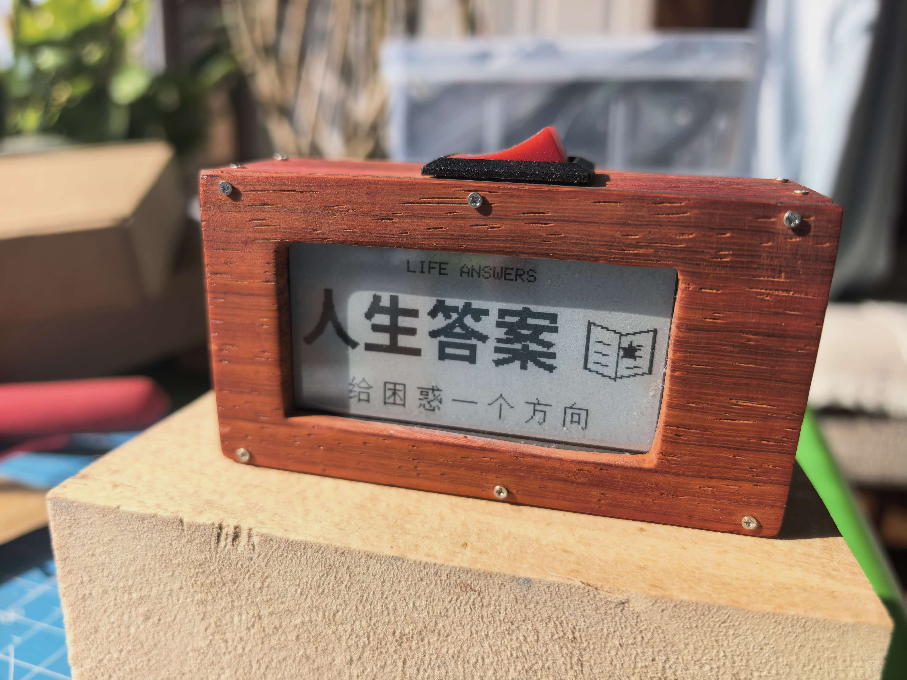
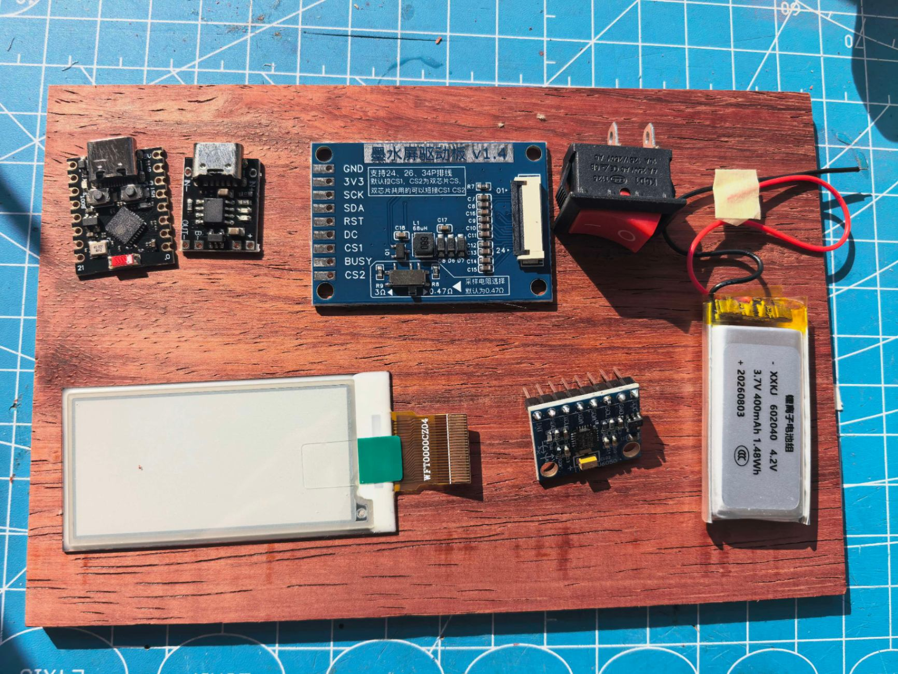
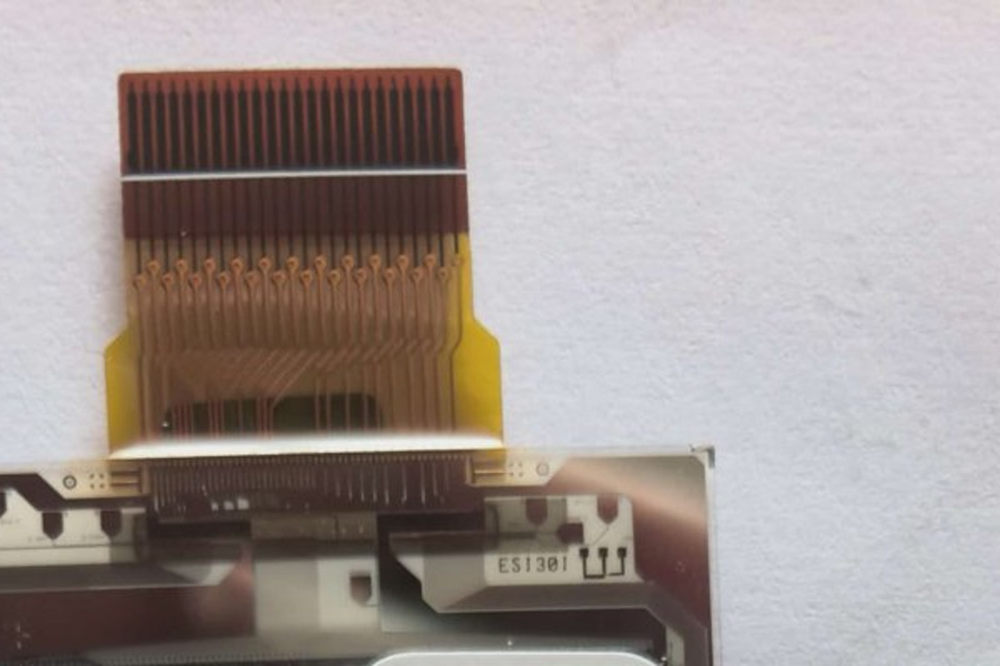

# Life Answers · 人生答案机

> 遇事不决，摇一摇——2.13 寸墨水屏浮现一条答案，英文在上、中文在下。

一块 ESP32-C3 SuperMini、一片 2.13" 墨水屏和一个 MPU6050，组成一台可以揣进口袋的
"答案机"：摇一摇出答案，静置回封面，再静置进深睡省电。

| 封面页 | 答案页 | 主要配件 |
|---|---|---|
|  |  |  |

墨水屏 · 驱动板 · ESP32-C3 · MPU6050 · 充电板 · 电池 · 电源开关

<p align="center">▶ <b>演示视频</b>（点击播放）—— 摇一摇出答案的完整过程</p>

https://github.com/user-attachments/assets/8f89910d-8d8a-48f6-842f-4db54fc625a8

| | |
|---|---|
| 主控 | ESP32-C3 SuperMini |
| 屏幕 | 2.13" WF0213T1PCZ04（UC8151 控制器，104×212，SPI） |
| 传感器 | MPU6050（I2C，加速度摇晃检测） |
| 电池 | 3.7V 锂电 + TP4056（可选，USB 供电亦可运行） |

## 功能

- **摇晃出答案**：内置 152 条中英双语原创答案，10ms 采样加速度，
  轻甩即触发（阈值可调）
- **答案页摇晃** → 立即回封面；**封面摇晃** → 显示新答案
- **6 秒无动静** → 自动回封面
- **封面静置 2 分钟** → 深度睡眠，每 2 秒短暂醒来检查一次，几乎不耗电
- **插着 USB 时永不深睡**，调试烧录不受影响
- 单次全屏刷新约 6 秒（墨水屏物理特性，等待时间经过实测标定）

## 目录结构

```
life-answers/
├── firmware/
│   ├── life-answers/      主固件 (Arduino 工程)
│   └── refresh-cal/      刷新时间标定工具 (可选, 用于确定屏幕最短稳定刷新)
├── content/
│   ├── answers_v2.txt    答案源数据 (英文|中文|分类)
│   ├── gen_answers_h.py  生成 firmware/life-answers/answers.h
│   ├── gen_cover.py      生成封面位图 cover.h (思源黑体渲染)
│   ├── gen_review.py     生成答案清单浏览页 answers_preview.html
│   └── fonts/            思源黑体 (SIL OFL 1.1)
├── docs/
│   ├── wiring.html       接线图
│   └── photos/           硬件照片
└── bin/                  预编译固件 (可直接烧录)
```

## 接线

### 墨水屏（经驱动板）→ ESP32-C3

| 信号 | GPIO |
|---|---|
| SCK | 2 |
| SDA (MOSI) | 3 |
| CS1 | 4 |
| DC | 5 |
| RST | 6 |
| BUSY | 7 |
| 3V3 / GND | 3V3 / GND |

> 避开 GPIO8/9（板载 LED/Boot）与 GPIO11 及以上（内部 Flash）。

### MPU6050 → ESP32-C3

| 信号 | GPIO |
|---|---|
| SCL | 0 |
| SDA | 1 |
| VCC / GND | 3V3 / GND |

详细引脚对照见 [docs/wiring.html](docs/wiring.html)。



## 编译烧录

### 方式一：Arduino IDE / arduino-cli

1. 安装 [Arduino IDE 2](https://www.arduino.cc/en/software) 与
   [ESP32 开发板支持包](https://docs.espressif.com/projects/arduino-esp32/en/latest/installing.html)
2. 安装库：`Adafruit GFX Library`、`U8g2_for_Adafruit_GFX`
3. 开发板选 **ESP32C3 Dev Module**，USB CDC On Boot: Enabled，
   Partition Scheme: **Huge APP**
4. 打开 `firmware/life-answers/life-answers.ino`，编译上传

命令行：

```bash
arduino-cli compile --fqbn "esp32:esp32:esp32c3:CDCOnBoot=cdc,PartitionScheme=huge_app" firmware/life-answers
arduino-cli upload -p COM口 --fqbn "esp32:esp32:esp32c3:CDCOnBoot=cdc,PartitionScheme=huge_app" --input-dir <编译输出目录> firmware/life-answers
```

### 方式二：直接烧录预编译固件

用乐鑫官方 [Flash Download Tool](https://www.espressif.com.cn/zh-hans/support/download/other-tools)
（芯片选 ESP32-C3，LoadMode 选 UART），只勾选一个文件：

```
bin/life-answers_merged.bin   地址 0x0
```

点 ERASE 全片擦除后 START 即可。

## 修改答案内容

答案文本全部在 `content/answers_v2.txt`，每行一条：

```
英文 | 中文 | 分类
```

分类用于人工管理（肯定/否定/时机/行动/放下/自省/关系/安慰/变化），
固件不区分分类、完全随机。改完后重新生成并编译：

```bash
cd content
python gen_answers_h.py     # 重新生成 answers.h
```

封面条带如需修改，改 `content/gen_cover.py` 后运行 `python gen_cover.py`。

## 参数调整

都在 `firmware/life-answers/life-answers.ino` 顶部：

| 宏 | 默认值 | 含义 |
|---|---|---|
| `SHAKE_G` | 1.20 | 触发阈值（|a|，越小越灵敏） |
| `JERK_G` | 0.35 | 相邻采样突变阈值（轻甩触发） |
| `QUIET_MS` | 6000 | 答案显示时长 |
| `SLEEP_MS` | 120000 | 封面静置多久深睡 |
| `POLL_S` | 2 | 深睡唤醒轮询周期（秒） |

刷新等待时间在 `firmware/life-answers/EPaper_213_Driver.h` 的 `REFRESH_WAIT_MS`
（默认 4600，来自实测标定；不同批次屏幕可能需要用 `firmware/refresh-cal`
重新标定）。

## 许可与声明

- 本项目代码以 [MIT License](LICENSE) 发布
- 第三方组件与字体许可见 [THIRD_PARTY.md](THIRD_PARTY.md)
- 本项目与 Carol Bolt 所著 *The Book of Answers*（《答案之书》）及任何在售图书
  均无关联，答案文本为本项目原创
- 本项目输出内容纯属娱乐，不构成任何决策建议
